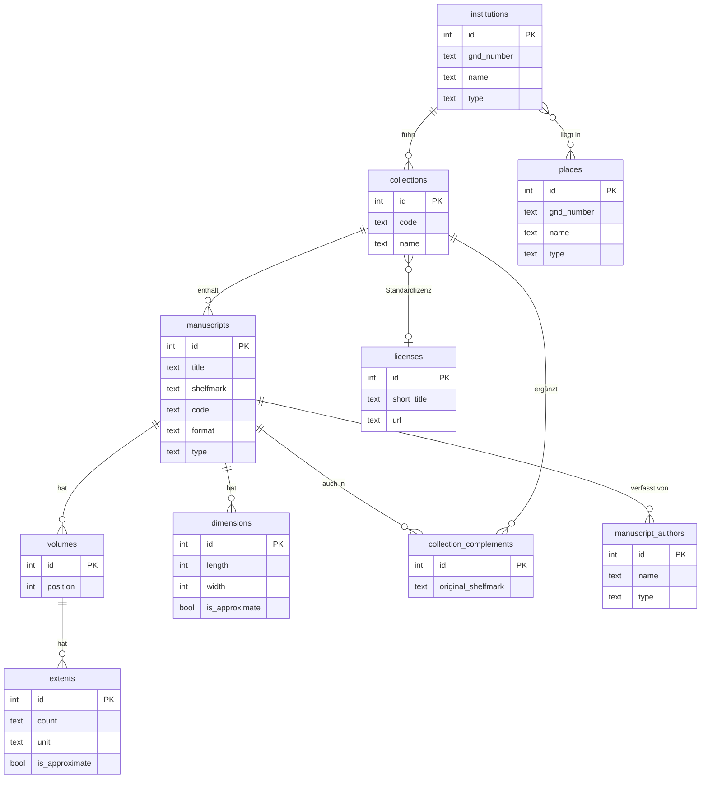
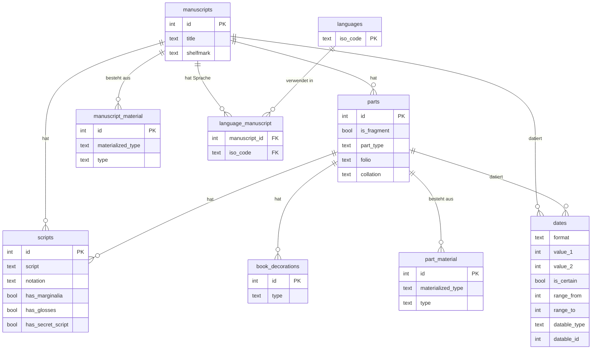
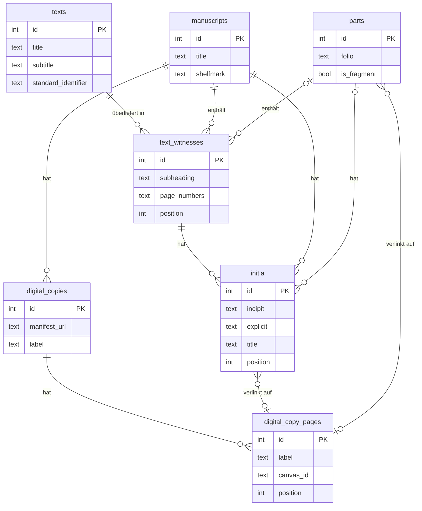
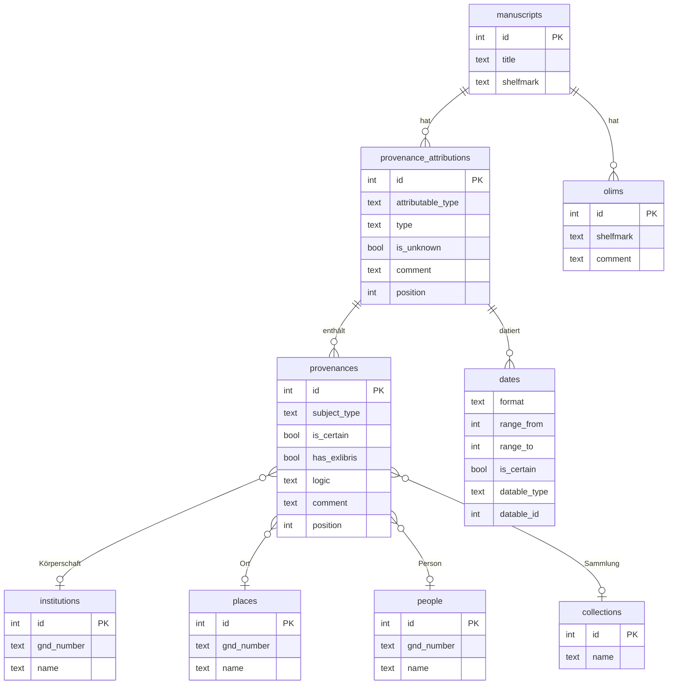
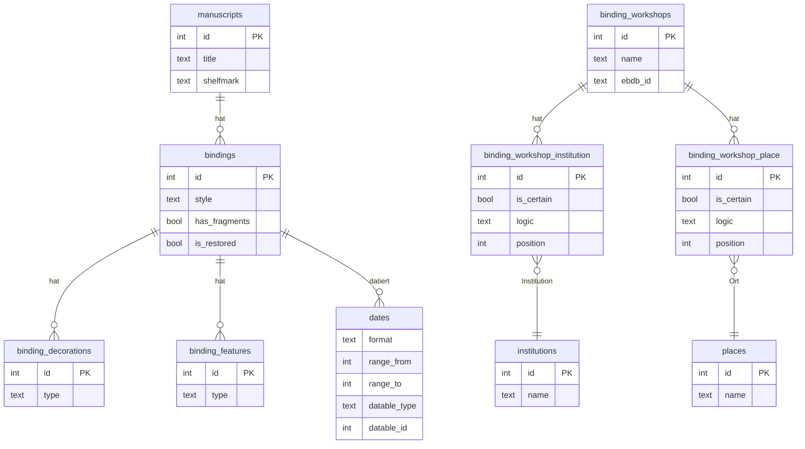
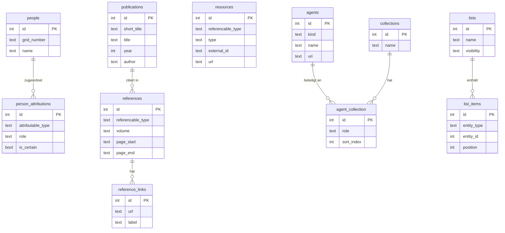

# Datenbankschema

Visuelle Übersicht der Datenbankstruktur, aufgeteilt nach thematischen Bereichen. Die vollständige Felddokumentation findet sich in [tabellen.md](tabellen.md).

---

## Handschriften und Sammlungen

Handschriften als zentrales Objekt mit ihrer institutionellen Einbettung, physischen Bänden und Maßangaben.

---

## Kodikologische Beschreibung

Physische und paläographische Eigenschaften der kodikologischen Teile.

---

## Texte und Überlieferung

Texte als abstrakte Werke und ihre Überlieferung in konkreten Handschriften, bis hin zu den einzelnen Textanfängen.

---

## Provenienzen

Herkunfts- und Besitzgeschichte von Handschriften und Einbänden, mit Verknüpfung zu Orten, Institutionen und Personen.

---

## Einband

Einbände mit Schmuck, Merkmalen und Werkstattzuordnung.

---

## Normadaten, Bibliographie und Zuordnungen

Personen, Publikationen, externe Ressourcen sowie Listen und Agenten.

